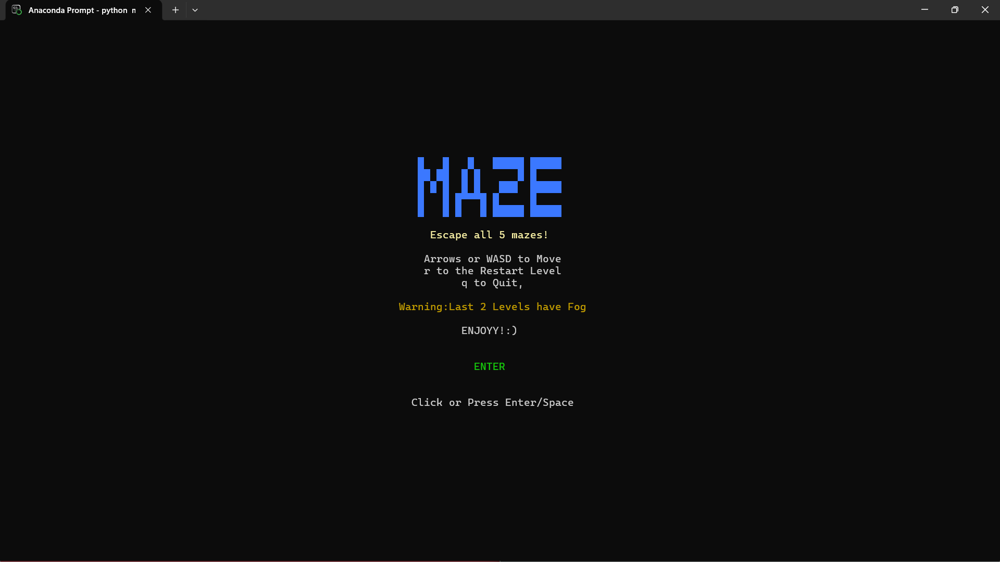
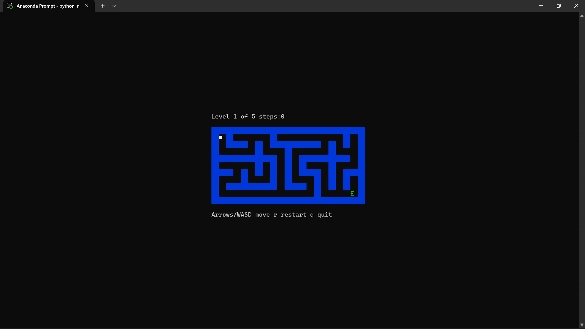
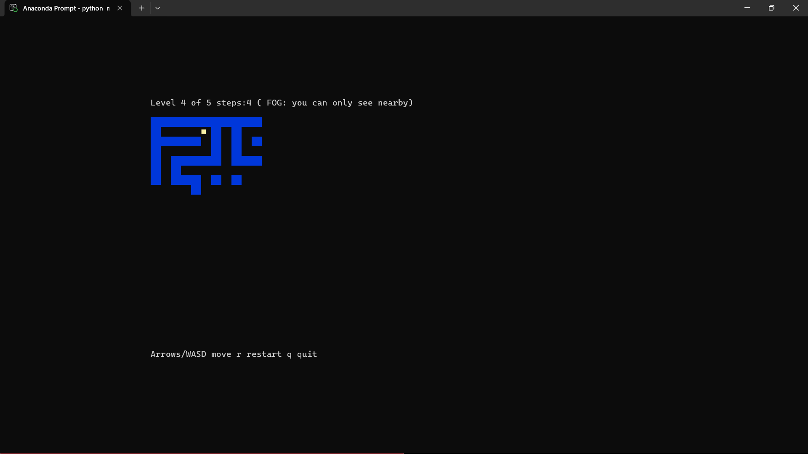

# MAZE THAT RUNS IN SHH
## Maze with 5 Levels that runs on ssh and built in pyhton.



# STEPS TO PLAY THIS GAME!!

## To Play Locally

Download and extract the latest release, then open a terminal in the folder containing maze.py.


Use Python 3.12 or newer and an interactive terminal

Make sure the curses add-on is installed. You only need to do this once. To install curses

Run in terminal:
```powershell
 pip install window-curses
```
Then run 

```powershell
python maze.py
```

# Features:

1.5 Levels with increasing difficulty

2.Top line showing Step count and the current level.

3.FOG at Level 4 & 5.You can only see the squares near you, but the game remembers what you’ve already explored, so the map slowly fills in as you walk.

4.Front page with a enter button.

## Some images of the game.

### FRONT PAGE

### LEVELs

### FOG


### NOTE
After so many crashouts finally it is done. I may add more features on future. Anyways I hope you enjoyed it and thanks for playing it!!


## Troubleshooting.
1. make sure your in the right folder.

2. make sure python is installed

3. use python3 or python if py doesnt work

4. if pip is installed and still giving error, use 'python -m pip install -r requirements.txt'

5. for any issues contact abhinanda5264@gmail.com

